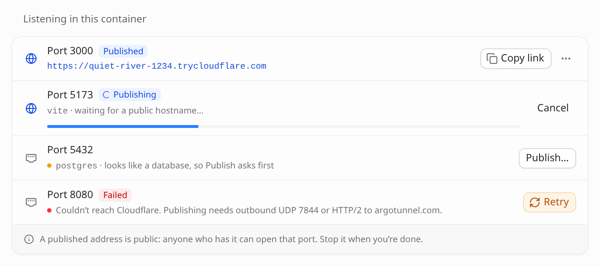

# Publishing a port

When you start a dev server in the container, yourself in a T3 Code terminal or
through an agent, it listens on a port nothing outside the container can reach:
not your phone, and not the browser on your laptop. Docker's answer is to
publish ports when the container starts, which means knowing the port in
advance, and still gives you no TLS or access from outside your LAN.

The setup page's **Ports** page lists what is listening and which process runs
it (`vite`, `next-server`), including servers bound to `127.0.0.1`, which is
the usual default. **Publish** gives you a public `https://` URL and a QR code
for opening it on another device. A port that looks like a database asks for
confirmation first.

<p align="center">
  
</p>

From a terminal:

```bash
t3-expose 3000        # publish it; prints the URL and a QR code
t3-expose             # what is listening, and what is published
t3-expose stop 3000   # take it down
```

`t3-expose` uses the same `/ports` API as the page, so the two always agree: a
port published from the terminal shows up on the page, and stopping it on the
page stops it for the terminal too.

Ports are published through a [Cloudflare quick
tunnel](https://developers.cloudflare.com/cloudflare-one/connections/connect-networks/do-more-with-tunnels/trycloudflare/),
which needs no account, DNS record or certificate. `cloudflared` is in the
image, pinned to the version T3 Code expects, so T3 Code doesn't download its
own copy for its managed tunnels.

Keep in mind:

- **A published URL is public.** It is random and stops working when you
  unpublish the port, but anyone with the URL can reach that port while it's
  published. Publish dev servers, not databases.
- **Publishing needs outbound access to Cloudflare:** UDP port 7844, or HTTP/2
  to `argotunnel.com`. If both are blocked, publishing fails with that message
  instead of giving you a URL that returns a 530 error.
